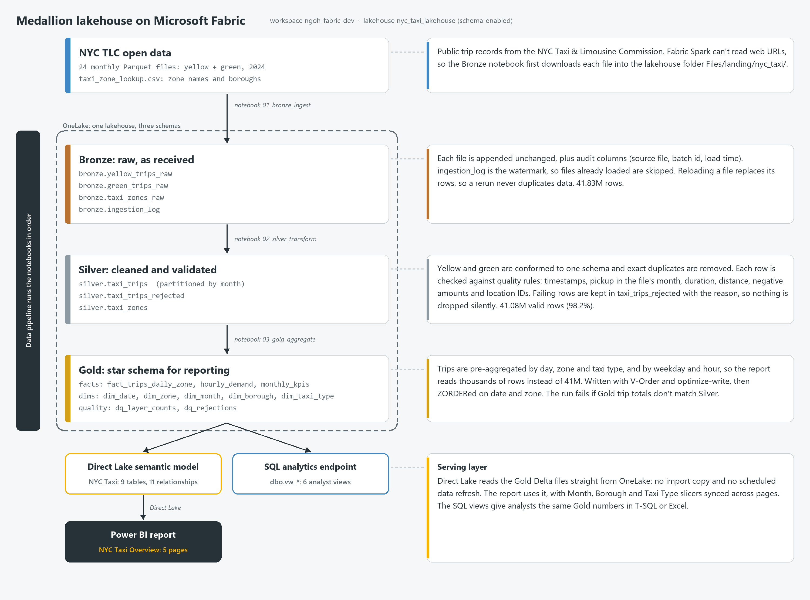
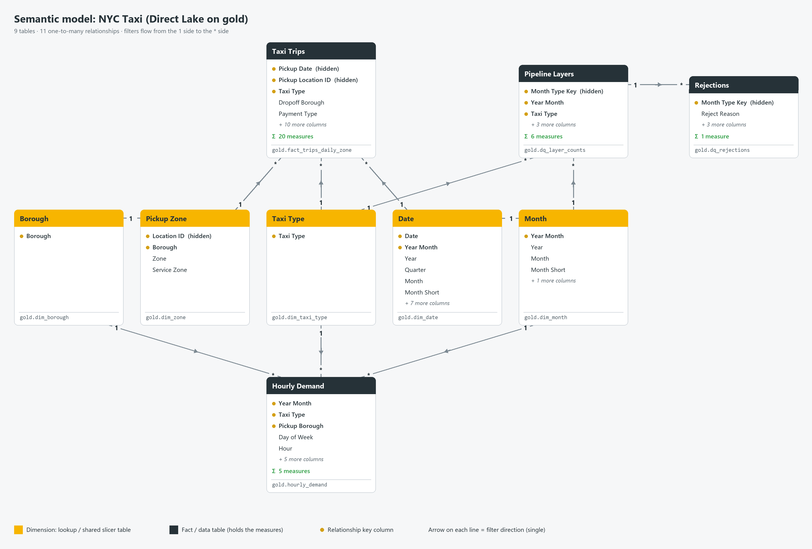
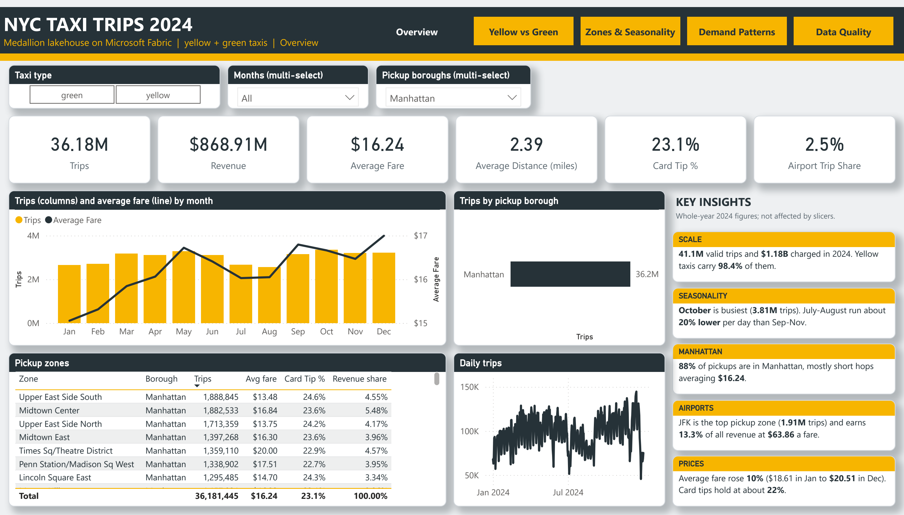
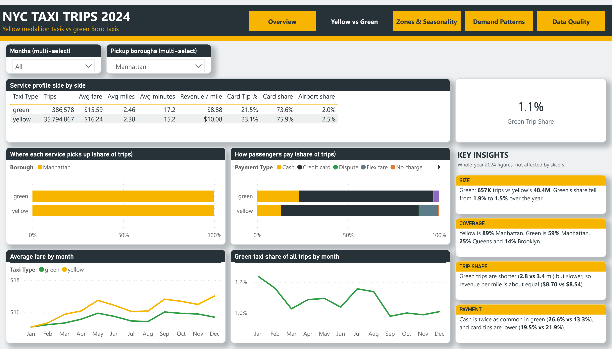
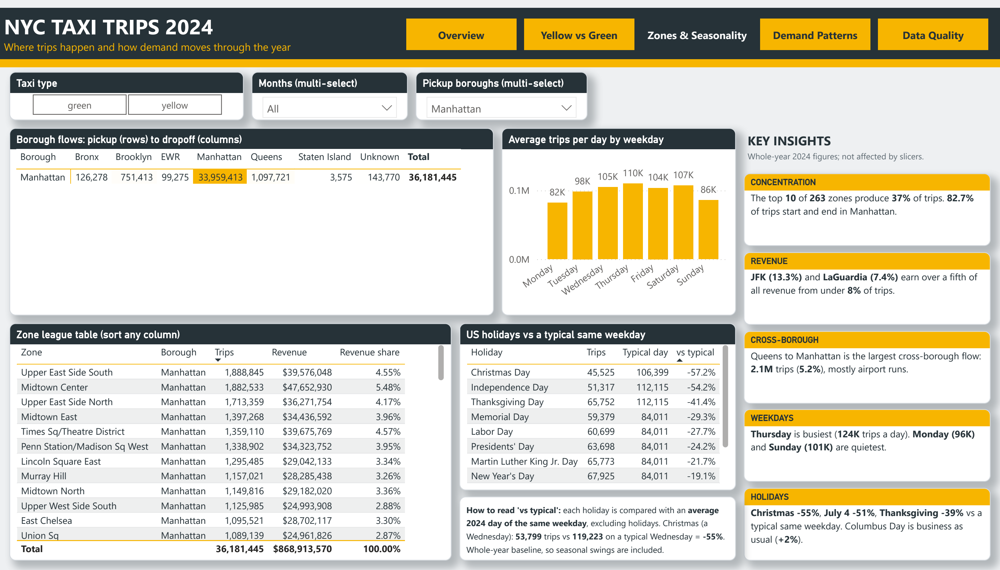
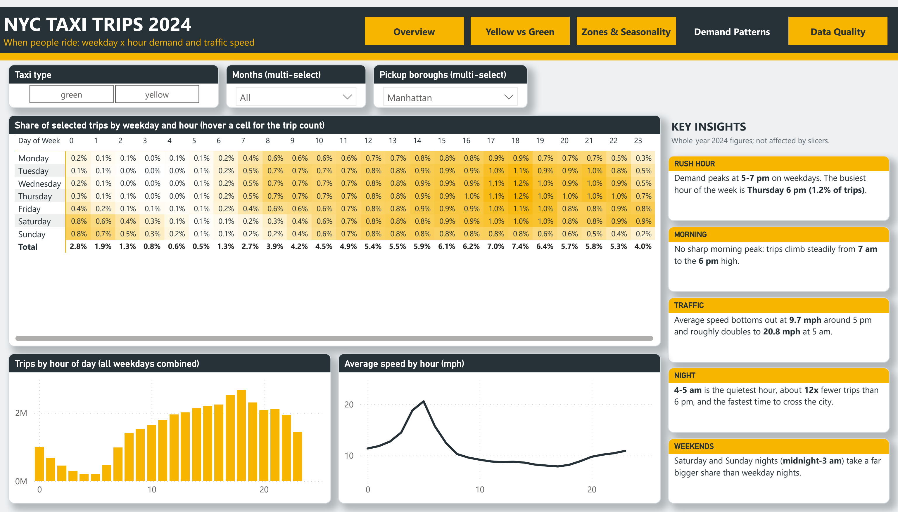
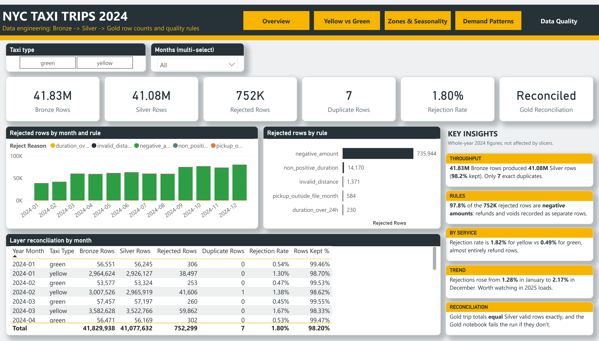

# NYC Taxi Trips 2024: Medallion Lakehouse on Microsoft Fabric

An end-to-end analytics build on Microsoft Fabric. It ingests the 2024 NYC TLC yellow and green taxi trip records, cleans them through a Bronze → Silver → Gold medallion lakehouse, and presents them in a five-page Power BI report on a Direct Lake semantic model.

Everything is deployed from code. The scripts in this repository create the notebooks, run them, build the semantic model and report, and add SQL views, all through the Fabric and Power BI REST APIs.

## Architecture



- **One schema-enabled lakehouse** (`nyc_taxi_lakehouse`) holds the `bronze`, `silver` and `gold` schemas, plus the analyst views in `dbo`.
- **Each layer is a notebook** in [`notebooks/`](notebooks), deployed and run through the Fabric REST API by [`src/fabric.py`](src/fabric.py) or the pipeline in [`src/pipeline.py`](src/pipeline.py).
- **Nothing is lost between layers:** Bronze row counts, Silver valid rows and rejected rows (with their reasons) are kept in `gold.dq_layer_counts` and `gold.dq_rejections`, and the Data Quality report page shows them.

## Semantic model



The Direct Lake model `NYC Taxi` reads the Gold tables straight from OneLake. Defined in [`src/semantic_model.py`](src/semantic_model.py); the TMDL is in [`powerbi/NYC Taxi.SemanticModel`](powerbi/NYC%20Taxi.SemanticModel).

- **Fact tables** (charcoal) hold the measures. *Taxi Trips* has trips, revenue, fares, tips and the holiday comparison; *Hourly Demand* feeds the weekday × hour heatmap; *Pipeline Layers* and *Rejections* feed the Data Quality page.
- **Dimension tables** (yellow) are the filters. *Month*, *Borough* and *Taxi Type* are shared by several fact tables, so one slicer filters every visual on every page. *Date* and *Pickup Zone* roll up to *Month* and *Borough*.
- **All relationships are one-to-many with single-direction filtering** (from the 1 side to the * side), which keeps totals predictable.
- The diagram is generated from the model definition by [`tools/make_diagrams.py`](tools/make_diagrams.py), so it can be redrawn whenever the model changes.

## Report snapshots (pickup borough = Manhattan)

### Overview


### Yellow vs Green


### Zones & Seasonality


### Demand Patterns


### Data Quality


The Data Quality page has no borough slicer because pipeline row counts are tracked per source file, not per borough. The Key Insights cards show whole-year 2024 figures and don't change with the slicers.

## Repository layout

```
notebooks/           Fabric notebook sources (deployed as .ipynb)
  01_bronze_ingest.py, 02_silver_transform.py, 03_gold_aggregate.py
  snippets/          one-off Spark snippets used while debugging (via tools/livy.py)
src/                 deployment code
  fabric.py          Fabric REST helper: Azure CLI auth, long-running operations, notebook deploy/run
  pipeline.py        Data pipeline that runs Bronze → Silver → Gold
  semantic_model.py  TMDL generator for the Direct Lake model; deploy, refresh, DAX queries
  report.py          PBIR generator for the report (pages, visuals, theme, insight cards)
  insights.json      text of the Key Insights cards
  sql_views.py       dbo.vw_* views on the SQL analytics endpoint
tools/               export pages to PDF/PNG, pull the report back to PBIP, draw the README diagrams, job history, Livy debugging
checks/              DAX and SQL verification scripts
powerbi/             Power BI project: open "NYC Taxi Overview.pbip" in Power BI Desktop
docs/                architecture and model diagrams; snapshots/ holds the page images
```

## Running it

Requirements: Python 3.12, the Azure CLI and a Fabric capacity (a trial works). Install the packages with `pip install requests pypdfium2 pillow mssql-python azure-identity`. Run all commands from the repository root.

1. `az login --allow-no-subscriptions`
2. Set `WORKSPACE` in `src/fabric.py` to your workspace name.
3. `python src/fabric.py deploy` to upload the notebooks, then run them in order with `python src/fabric.py run 01_bronze_ingest` (then `02_silver_transform` and `03_gold_aggregate`). Alternatively, use `python src/pipeline.py deploy` to create a pipeline that runs all three.
4. `python src/semantic_model.py deploy`, then `python src/semantic_model.py refresh`.
5. `python src/report.py deploy`
6. `python src/sql_views.py`

Useful extras:
- `python tools/download_report.py powerbi` refreshes the PBIP report in `powerbi/` from the live report.
- `python tools/export_page.py <page> <out.pdf>` exports one page as a PDF and PNG.
- To snapshot the pages for one borough, run `src/report.py deploy` with `NYC_REPORT_NAME` set to a new report name and `NYC_PRESELECT_BOROUGH` set to the borough. Then run `tools/export_page.py` with the same `NYC_REPORT_NAME`, and delete the copy afterwards.

## Data source

[NYC Taxi & Limousine Commission trip record data](https://www.nyc.gov/site/tlc/about/tlc-trip-record-data.page), January to December 2024.

## License

[MIT](LICENSE)
